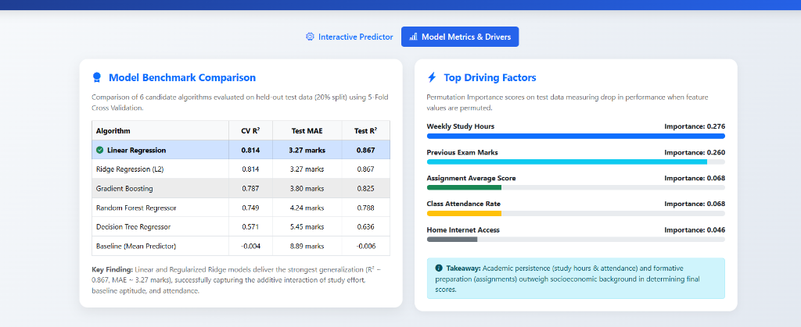

# 🎓 Student Academic Performance Prediction & Early Intervention System

[](https://www.python.org/)
[](https://scikit-learn.org/)
[](https://flask.palletsprojects.com/)
[](https://getbootstrap.com/)
[](https://www.brainwareuniversity.ac.in/)

An end-to-end, interpretable **Machine Learning** application designed to estimate a student's final examination marks (0–100) and academic standing using academic, behavioural, and contextual factors. The system provides early identification for students needing academic assistance alongside personalized, evidence-grounded educational guidance.

---

## 👩‍🎓 Academic Project Credentials

* **Student Name:** Muskan Singh
* **Student Code:** BWU/BCA/24/114
* **Roll Number:** 24103460109
* **Registration Number:** 24103002891
* **Degree:** Bachelor of Computer Application (BCA), Section B
* **Department:** Department of Computational Science
* **Institution:** Brainware University, Kolkata, West Bengal - 700 125
* **Project Supervisor:** Dr. Rahul Kumar Ghosh, Assistant Professor
* **Course:** Machine Learning | **Course Code:** BCA57205(P)

---

## 📄 Project Documentation & Presentation

| Document | Format | Link / Path |
| :--- | :---: | :--- |
| **Comprehensive Project Report** | PDF | [Student_Academic_Performance_Predictor_Report.pdf](docs/Student_Academic_Performance_Predictor_Report.pdf) |
| **Official Presentation Deck** | PPTX | [Student_Academic_Performance_Presentation.pptx](docs/Student_Academic_Performance_Presentation.pptx) |
| **Data Dictionary & Variable Glossary** | Markdown | [data_dictionary.md](data/data_dictionary.md) |
| **Evaluation & Metrics Summary** | Markdown | [reports/evaluation_report.md](reports/evaluation_report.md) |

---

## 📌 Project Highlights & Key Features

1. **Multi-Factorial Educational Analytics:** Integrates 12 input features covering academic track record, continuous coursework, study hours, classroom engagement, sleep duration, stress levels, and digital access.
2. **Zero Data Leakage Protocol:** 80/20 train/test splitting performed strictly before fitting any imputation or scaling transformers.
3. **Multi-Algorithm Benchmarking:** Evaluates 6 models using **5-Fold Cross-Validation** (Baseline, Decision Tree, Random Forest, Gradient Boosting, Ridge Regression, and Linear Regression).
4. **Permutation Feature Importance:** Model-agnostic extraction of the most impactful behavioral and academic drivers.
5. **Interactive Flask Web Dashboard:** Features real-time sliders, color-coded academic standing badges, 95% confidence intervals, and automated recommendations.
6. **Multiple Execution Modes:** Web dashboard (`app.py`), full EDA and terminal analytics (`main.py`), and interactive user CLI (`user_predict.py`).

---

## 📊 Model Evaluation & Benchmarking Results

All models were evaluated on the held-out test partition ($N=240$ students, 20% split) using 5-Fold Cross-Validation:

| Model Algorithm | 5-Fold CV $R^2$ (Mean ± SD) | Test MAE (Marks) | Test RMSE (Marks) | Test $R^2$ Score | Performance Rank |
| :--- | :---: | :---: | :---: | :---: | :---: |
| **Linear Regression** | **0.814 ± 0.037** | **3.269** | **4.109** | **0.8671** | 🏆 **Best Model** |
| **Ridge Regression ($\alpha=1.0$)** | **0.814 ± 0.037** | **3.274** | **4.112** | **0.8669** | 🥈 Runner-up |
| **Gradient Boosting Regressor** | 0.786 ± 0.030 | 3.784 | 4.694 | 0.8270 | 🥉 Strong Non-Linear |
| **Random Forest Regressor** | 0.749 ± 0.026 | 4.254 | 5.194 | 0.7880 | Tree Ensemble |
| **Decision Tree Regressor** | 0.571 ± 0.068 | 5.450 | 6.804 | 0.6360 | Single Tree Baseline |
| **Dummy Regressor (Mean Baseline)** | -0.004 ± 0.005 | 8.892 | 11.305 | -0.0064 | Naive Baseline |

> **Key Finding:** Linear Regression achieved the lowest Mean Absolute Error (**3.27 marks out of 100**) and highest $R^2$ (**0.8671**), successfully capturing the cumulative, additive nature of student effort without overfitting.

---

## 🔍 Top Driving Factors (Permutation Feature Importance)

Permutation importance scores on unseen test data indicate the drop in model $R^2$ when a feature is shuffled:

| Rank | Feature | Importance Score | Educational Takeaway |
| :---: | :--- | :---: | :--- |
| **1** | **Weekly Study Hours** | **0.276** | Primary controllable behavioral driver of academic marks. |
| **2** | **Previous Exam Marks** | **0.260** | Strong foundational signal of prior subject mastery. |
| **3** | **Assignment Average Score** | **0.068** | Continuous formative assessments reinforce exam readiness. |
| **4** | **Class Attendance Rate** | **0.068** | Direct exposure to classroom instruction and discipline. |
| **5** | **Home Internet Access** | **0.046** | Digital equity factor enabling access to study resources. |
| **6** | **Parent Education Level** | **0.032** | Supportive home academic environment. |
| **7** | **Perceived Stress Level** | **0.028** | Elevated stress acts as a negative drag on test scores. |
| **8** | **Tutoring Support** | **0.023** | Targeted remedial support helps recover grades for at-risk students. |

---

## 🖼️ System Screenshots & Visualizations

### 1. Web Dashboard - Model Metrics & Drivers


### 2. Exploratory Data Analysis & Residual Diagnostics
* **Distribution of Final Exam Marks & Tiers:** [`reports/figures/plot1_target_distribution.png`](reports/figures/plot1_target_distribution.png)
* **Correlation Heatmap:** [`reports/figures/plot2_correlation_heatmap.png`](reports/figures/plot2_correlation_heatmap.png)
* **Scatter Plots with Regression Trendlines:** [`reports/figures/plot3_scatterplots.png`](reports/figures/plot3_scatterplots.png)
* **Box Plots (Stress & Parent Education):** [`reports/figures/plot4_boxplots.png`](reports/figures/plot4_boxplots.png)
* **Actual vs. Predicted Marks:** [`reports/figures/plot5_actual_vs_predicted.png`](reports/figures/plot5_actual_vs_predicted.png)
* **Permutation Feature Importance:** [`reports/figures/plot6_feature_importance.png`](reports/figures/plot6_feature_importance.png)

---

## 📂 Project Repository Structure

```text
student_performance_prediction/
│
├── data/
│   ├── student_performance.csv          # 1,200 student records
│   └── data_dictionary.md               # Variable definitions & grading rubrics
│
├── docs/
│   ├── Student_Academic_Performance_Predictor_Report.pdf   # 22-page official project report
│   └── Student_Academic_Performance_Presentation.pptx      # Official presentation deck
│
├── models/
│   ├── best_model.joblib                # Serialized trained Scikit-Learn pipeline
│   ├── feature_metadata.json            # Permutation importance & standardized coefficients
│   └── metrics_summary.json             # 5-fold CV & test evaluation metrics
│
├── reports/
│   ├── evaluation_report.md             # Formal evaluation summary
│   ├── eda_summary.json                 # Statistical profile of data distributions
│   └── figures/                         # High-resolution diagnostic charts & dashboard previews
│
├── src/
│   ├── generate_data.py                 # Empirically-grounded student dataset generator
│   ├── preprocess.py                    # Leak-free ColumnTransformer pipeline
│   ├── eda.py                           # Exploratory Data Analysis script
│   ├── train.py                         # 6-model benchmarking & validation engine
│   └── predict.py                       # Prediction engine with personalized recommendations
│
├── templates/
│   └── index.html                       # Responsive Bootstrap 5 interactive UI
│
├── app.py                               # Flask web server & REST API
├── main.py                              # Complete academic terminal analysis & plot script
├── user_predict.py                      # Interactive terminal prompt for custom predictions
├── run_dashboard.bat                    # One-click Windows launcher for web dashboard
├── run_analysis.bat                     # One-click Windows launcher for terminal analysis
├── predict_input.bat                    # One-click Windows launcher for user input demo
├── requirements.txt                     # Pinned project dependencies
├── .gitignore                           # Git ignore configuration
└── README.md                            # Comprehensive project manual
```

---

## ⚡ Quickstart Guide (How to Run)

### 1. Clone the Repository
```bash
git clone https://github.com/29MuskanSingh/Student-Academic-Performance-Predictor.git
cd Student-Academic-Performance-Predictor
```

### 2. Create and Activate Virtual Environment
```bash
# Windows
python -m venv .venv
.\.venv\Scripts\activate

# Linux / macOS
python3 -m venv .venv
source .venv/bin/activate
```

### 3. Install Dependencies
```bash
pip install -r requirements.txt
```

### 4. Run Modes

#### Option A: Interactive Web Dashboard (Recommended)
```bash
python app.py
```
Open **`http://127.0.0.1:5000`** in any web browser to access the interactive sliders, real-time predictions, and model metrics.
*(On Windows, you can simply double-click `run_dashboard.bat`)*

#### Option B: Terminal Analysis with Visual Plots
```bash
python main.py
```
Prints `df.head()`, `df.describe()`, missing values, model comparison tables, and displays all 6 diagnostic charts.
*(On Windows, you can double-click `run_analysis.bat`)*

#### Option C: Live Terminal User Input Prediction
```bash
python user_predict.py
```
Prompts for student attendance, study hours, previous marks, and outputs predicted marks with personalized counseling tips.
*(On Windows, you can double-click `predict_input.bat`)*

---

## 🎯 Academic Performance Tiers

| Tier Name | Marks Range | Color Badge | Meaning & Academic Action |
| :--- | :---: | :---: | :--- |
| **Distinction** | $\ge 80.0$ | 🟢 Green | High academic achievement; maintain study-rest balance. |
| **Good** | $65.0 - 79.9$ | 🔵 Blue | Above-average proficiency; focus on targeted areas for distinction. |
| **Pass** | $50.0 - 64.9$ | 🟡 Yellow | Satisfactory baseline; recommended to increase weekly study hours. |
| **At-Risk** | $< 50.0$ | 🔴 Red | Immediate remedial intervention, tutoring, and attendance monitoring required. |

---

## 📜 References & Acknowledgements

Special thanks to **Dr. Rahul Kumar Ghosh** (Assistant Professor & Project Supervisor) and **Dr. Jayanta Aich** (Head of the Department of Computational Science), Brainware University, for their guidance, mentorship, and encouragement throughout this project.

1. Pedregosa et al., *"Scikit-learn: Machine Learning in Python,"* Journal of Machine Learning Research, vol. 12, pp. 2825–2830, 2011.
2. Hastie, Tibshirani, and Friedman, *"The Elements of Statistical Learning: Data Mining, Inference, and Prediction,"* Springer, 2009.
3. Flask Documentation: [https://flask.palletsprojects.com/](https://flask.palletsprojects.com/)
4. Scikit-learn User Guide: [https://scikit-learn.org/stable/user_guide.html](https://scikit-learn.org/stable/user_guide.html)

---

## 📄 License
This project is open-source and available under the [MIT License](LICENSE).
